<table>
  <tr>
    <td width="380" valign="top">
      
      Imagens da personagem geradas no site:  
      (https://jazzybee.itch.io/sdvcharactercreator)
    </td>
    <td valign="center">

# Hello World, Anna Clara aqui!
Sou Designer UI/UX, Analista de Dados e Desenvolvedora Front-End   EN I'm UI/UX Designer, Data Analyst e Front-End Developer  

### Formação | Graduation
- Ciência da Computação, FNR · 2024 - 2028
- Design Gráfico, IFPE · 2020 - 2022

### Ferramentas | Tools

**Design** 
 &nbsp;
 &nbsp;
 &nbsp;
 &nbsp;
  

**Dados | Data ** 

**Programação | Programming** 
 &nbsp;
 &nbsp;
 &nbsp;
 &nbsp;
 &nbsp;

**Redes Sociais | Social ** 

    </td>
  </tr>
</table>

<!---
abclara/abclara is a ✨ special ✨ repository because its `README.md` (this file) appears on your GitHub profile.
You can click the Preview link to take a look at your changes.
--->
